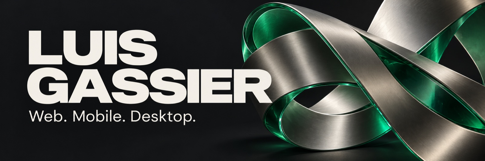
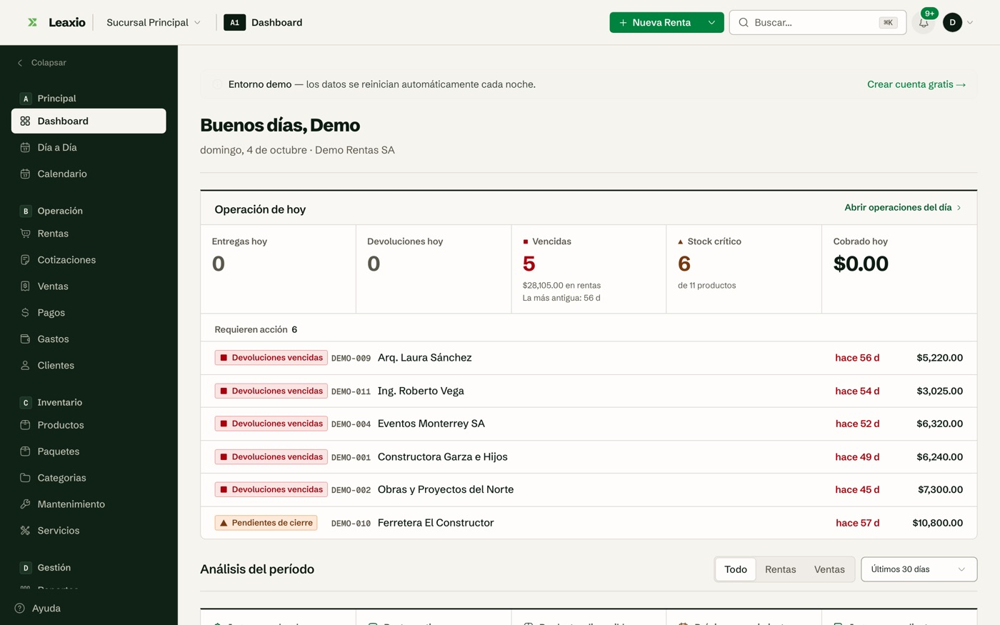
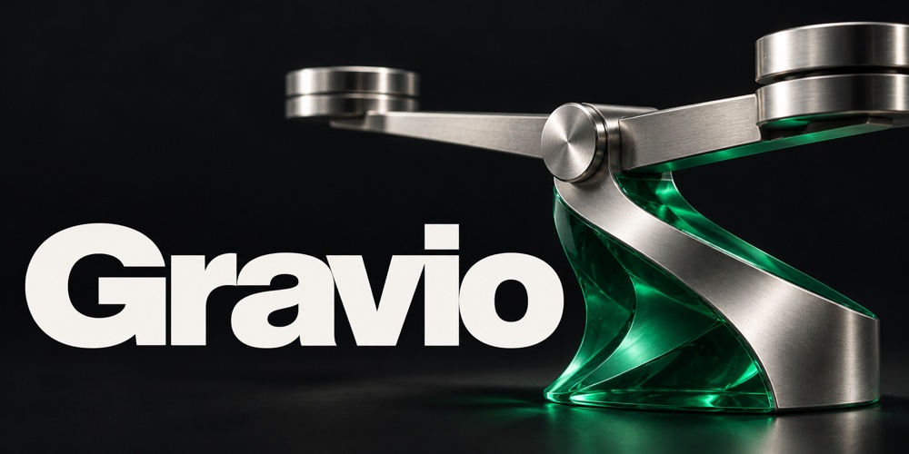
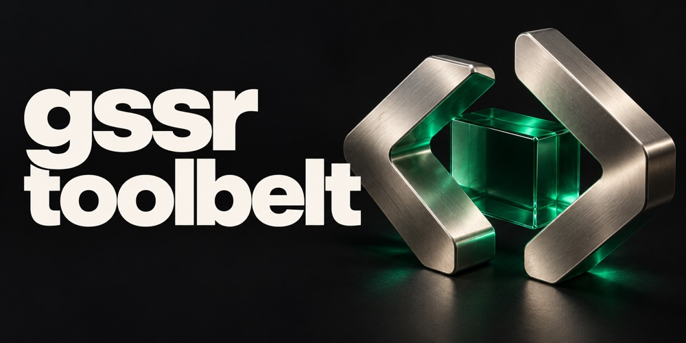

<h1 align="center">Software for the way businesses work.</h1>

<strong>Full-stack developer · Product development · Software architecture</strong>

I build web, mobile, and desktop software — from rental platforms to offline operations and tools for developers.

  
  
  

## My toolkit

TypeScript · React · Next.js · Node.js · Flutter · Dart · Electron · Supabase · PostgreSQL

## Selected work

### [Leaxio](https://leaxio.com) · Rental operations, connected.

A multi-tenant POS for inventory, customers, rentals, and payments. 
Next.js, TypeScript, and Supabase, with role-based permissions and tenant isolation.

Product screenshot with demo data. [Explore Leaxio →](https://leaxio.com)

  

<table>
<tr>
<td width="50%" valign="top">

<h3><a href="https://github.com/LuisGassier/gravio-electron">Gravio ↗</a></h3>

Desktop software for landfill operations: weighbridge readings, thermal receipts, and offline synchronization.

Electron · React · TypeScript · Supabase

</td>
<td width="50%" valign="top">

<h3><a href="https://github.com/LuisGassier/gssr-toolbelt">gssr-toolbelt ↗</a></h3>

Reusable skills and conventions for AI coding assistants, with frontend polish and a template for new skills.

Developer tools · AI workflows · Markdown

</td>
</tr>
</table>

Gravio and toolbelt images are illustrated project covers.

## How I build

- **Start with the workflow.** Clear interfaces for the people using the software.
- **Give the code structure.** Business responsibilities, explicit permissions, and clear data boundaries.
- **Connect the pieces.** Web, mobile, desktop, and hardware integrations.

---

<h2 align="center">Have a product, project, or role in mind?</h2>

Let's talk about what we could build together.

También podemos conversar en español.

